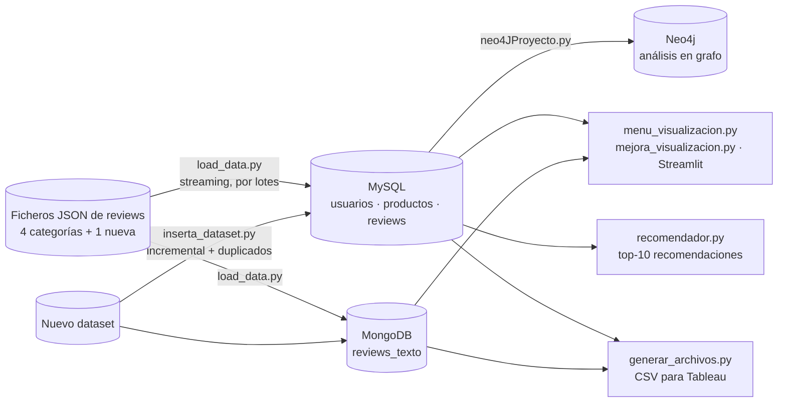
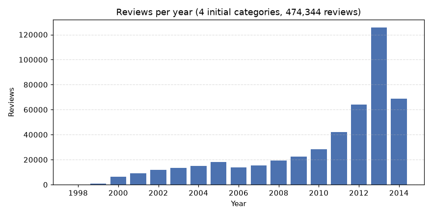
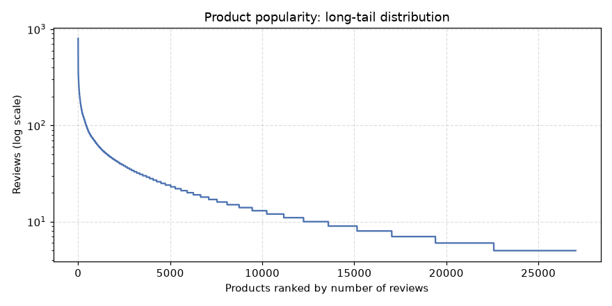
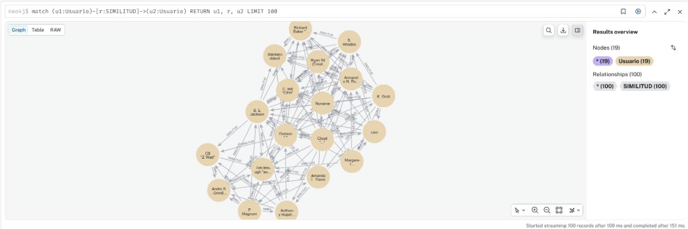
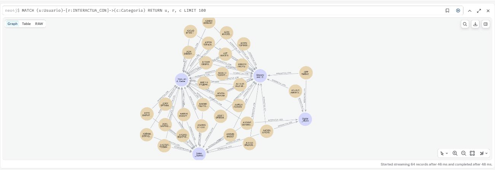

[English](README.md) | **Español**

# Reviews de Amazon: persistencia políglota con MySQL, MongoDB y Neo4j

Una plataforma de datos para **474.344 reviews de productos de Amazon** que combina tres modelos de bases de datos, cada uno usado para lo que mejor hace:

- **MySQL** para la parte estructurada y relacional (usuarios, productos, notas, fechas)
- **MongoDB** para el texto libre (cuerpo y resumen de la review)
- **Neo4j** para el análisis en grafo (similitud entre usuarios, redes usuario–producto y usuario–categoría)

Sobre las bases de datos hay un cargador de datos en streaming, un menú de visualización, un **dashboard interactivo en Streamlit**, un cargador incremental de nuevos datasets con detección de duplicados y un **recomendador** basado en popularidad.

> Proyecto en pareja con **Lola Mancebo Olivares** para la asignatura *Bases de Datos*, 2º curso del Grado en Ingeniería Matemática e Inteligencia Artificial, ICAI – Universidad Pontificia Comillas (curso 2025/26).


---

## Arquitectura



## Modelo de datos

**¿Por qué repartir así los datos?** Las notas, los votos y las fechas tienen una estructura fija y se consultan con joins y agregaciones, así que van a MySQL. El texto de las reviews tiene longitud variable y solo se lee completo (por ejemplo, para las nubes de palabras), lo que encaja con una base de datos documental. La capa de grafo se construye *a partir de* MySQL cuando se necesita, para analizar relaciones que serían incómodas de expresar en SQL.

**MySQL (esquema relacional)**

```
usuarios (reviewer_id PK, reviewer_name)
productos (asin PK, categoria)
reviews  (review_id PK, reviewer_id FK → usuarios, asin FK → productos,
          overall, helpful_yes, helpful_total, unix_review_time, review_time DATE)
```

Un mismo usuario puede tener reviews en varias categorías, así que usuarios y productos se guardan una sola vez y las reviews los referencian. `reviewTime` (`"07 9, 2012"`) se convierte a un tipo `DATE`. Los índices sobre `reviewer_id`, `asin` y `review_time` aceleran las consultas más frecuentes.

**MongoDB (documental)**

```
reviews_texto { _id, reviewerID, asin, categoria, unix_review_time, reviewText, summary }
```

**Neo4j (modelos de grafo construidos desde MySQL)**

| Análisis | Nodos | Relaciones |
|---|---|---|
| Similitud entre usuarios (los 30 más activos) | `Usuario` | `SIMILITUD {pearson, articulos_comunes}` |
| Usuarios ↔ productos aleatorios de una categoría | `Usuario`, `Articulo` | `PUNTUO {overall, unix_review_time}` |
| Usuarios multicategoría (los 400 primeros por nombre) | `Usuario`, `Categoria` | `INTERACTUA_CON {num_articulos}` |
| Los 5 productos más populares con < 40 reviews | `Usuario`, `Articulo` | `PUNTUO`, `TIENE_EN_COMUN {articulos_comunes}` |

La similitud entre usuarios es la correlación de Pearson sobre los productos que ambos han puntuado, implementada desde cero en Python.

## Resultados

<p align="center">
  
  
</p>

- **Crecimiento:** la actividad crece de forma sostenida desde 1998 y alcanza su máximo en 2013 (125.705 reviews). La caída de 2014 se debe a que el dataset termina a mitad de ese año.
- **Cola larga:** hay 27.025 productos. El más valorado tiene 802 reviews y la mediana solo 10; el 10 % de productos más populares concentra el **41 %** de todas las reviews.
- **Carga incremental:** el dataset *Grocery and Gourmet Food* (151.254 reviews) se añade a la base de datos existente sin reconstruirla. Si se vuelve a ejecutar el script, no inserta nada nuevo: detecta todas las reviews como duplicadas.

<p align="center">
  
  
</p>

*Izquierda:* red de similitud entre los usuarios más activos (las relaciones `SIMILITUD` guardan el coeficiente de Pearson). *Derecha:* usuarios que han valorado productos de varias categorías, unidos a cada categoría con el número de productos que han valorado en ella.

<p align="center">
  
</p>

*Nube de palabras de los resúmenes de reviews de Toys and Games (palabras de más de 3 letras), obtenida de MongoDB.*

**Recomendador.** Dado un usuario y una categoría, `recomendador.py` devuelve los 10 productos más populares de esa categoría que el usuario todavía no ha valorado, usando la nota media para desempatar. También se exploró un modelo de filtrado colaborativo basado en usuarios (KNN sobre la similitud de Pearson). Solo alcanzó una tasa de acierto del 3,33 % por la gran dispersión de la matriz usuario–producto, así que no se incluyó en la versión final.

## Estructura del repositorio

```
amazon-reviews-polyglot-db/
├── src/
│   ├── configuracion.py        # Nombres de BBDD, credenciales (desde .env) y rutas de datos
│   ├── db.py                   # Conexiones comunes y lectura del JSON
│   ├── load_data.py            # Parte 1: crea las BBDD y carga los 4 datasets
│   ├── menu_visualizacion.py   # Parte 2: menú por terminal con 7 gráficas
│   ├── neo4JProyecto.py        # Parte 3: menú de Neo4j con 4 análisis en grafo
│   ├── inserta_dataset.py      # Parte 4: carga incremental de un nuevo dataset
│   ├── recomendador.py         # Parte 5: top-10 productos populares no valorados
│   ├── generar_archivos.py     # Parte 5: CSV para Tableau
│   └── mejora_visualizacion.py # Opcional: dashboard en Streamlit
├── exports/                    # CSV exportados del dataset completo
├── docs/figures/               # Figuras de este README
├── report/                     # Memoria completa y póster
├── data/                       # Aquí van los JSON descargados (ignorados por git)
├── docker-compose.yml          # MySQL + MongoDB + Neo4j
├── .env.example                # Plantilla de credenciales
└── requirements.txt
```

## Cómo reproducir los resultados

**Requisitos:** Python 3.12 y Docker (o instalaciones locales de MySQL 8, MongoDB 7 y Neo4j 5).

1. **Clonar el repositorio e instalar las dependencias**
   ```bash
   git clone https://github.com/jimenazubii/amazon-reviews-polyglot-db.git
   cd amazon-reviews-polyglot-db
   python3.12 -m venv .venv
   source .venv/bin/activate          # Windows: .venv\Scripts\activate
   pip install -r requirements.txt
   ```

2. **Configurar las credenciales.** Copia la plantilla y pon tus propias contraseñas:
   ```bash
   cp .env.example .env
   ```
   La contraseña de Neo4j debe tener al menos 8 caracteres. `.env` está en `.gitignore`, así que las credenciales nunca llegan al repositorio.

3. **Arrancar las bases de datos**
   ```bash
   docker compose up -d
   ```
   Arranca MySQL (puerto 3306), MongoDB (27017) y Neo4j (navegador en http://localhost:7474, Bolt en 7687) con las credenciales de `.env`.

4. **Descargar los datos.** Descarga los ficheros de reviews *5-core* de Toys and Games, Video Games, Digital Music, Musical Instruments y Grocery and Gourmet Food desde la [página de Amazon product data (2014)](https://jmcauley.ucsd.edu/data/amazon/links.html). Descomprímelos en `data/` y renómbralos así:
   ```
   data/Toys_and_Games_5.json
   data/Video_Games_5.json
   data/Digital_Music_5.json
   data/Musical_Instruments_5.json
   data/Grocery_and_Gourmet_Food_5.json
   ```
   En total ocupan unos 660 MB y no están incluidos en el repositorio. Puedes usar otra carpeta indicándola en `DATA_DIR` dentro de `.env`.

5. **Cargar los datos** (crea desde cero la base de datos MySQL, las tablas y la colección de MongoDB):
   ```bash
   python src/load_data.py
   ```
   Salida esperada: `Toys_and_Games: 167597`, `Video_Games: 231780`, `Digital_Music: 64706` y `Musical_Instruments: 10261` reviews procesadas.

6. **Explorar los datos**
   ```bash
   python src/menu_visualizacion.py           # menú por terminal con 7 gráficas
   streamlit run src/mejora_visualizacion.py  # dashboard interactivo
   python src/neo4JProyecto.py                # análisis en grafo; después abre http://localhost:7474
   ```

7. **Carga incremental, recomendaciones y exportaciones**
   ```bash
   python src/inserta_dataset.py   # añade Grocery and Gourmet Food (151.254 reviews)
   python src/inserta_dataset.py   # otra vez: 0 nuevas, 151.254 duplicadas detectadas
   python src/recomendador.py      # p. ej., usuario A2HD75EMZR8QLN, categoría Video_Games
   python src/generar_archivos.py  # regenera los CSV de exports/
   ```

## Cambios respecto a la entrega de la asignatura

Esta versión para portfolio mantiene el diseño y la lógica originales, con estas mejoras:

- **Credenciales fuera del código:** se leen de un fichero `.env` ignorado por git, y la ruta de los datos es configurable.
- **App de Streamlit arreglada:** el fichero original contenía marcadores de conflicto de merge de Git sin resolver y no arrancaba. Además, dos gráficas (histograma de notas y evolución acumulada) ignoraban la categoría seleccionada; ahora filtran por ella. Las consultas se guardan en caché con `st.cache_data` y el eje temporal muestra fechas en lugar de timestamps Unix.
- **Módulo común (`db.py`):** el código de conexión y lectura que estaba duplicado en seis scripts está ahora en un único sitio.
- **Documentos de MongoDB coherentes:** los dos cargadores guardan `unix_review_time`. El cargador incremental detecta también duplicados dentro del mismo fichero.
- **Entorno reproducible:** `docker-compose.yml`, `requirements.txt` con versiones fijadas y la plantilla `.env.example`.

El pipeline refactorizado se ha vuelto a probar de principio a fin sobre MariaDB 10.11 (compatible con MySQL), con un MongoDB en memoria (mongomock) y un driver de Neo4j simulado, usando una muestra de los datos reales. El proyecto original se ejecutó sobre servidores locales de MySQL, MongoDB y Neo4j.

## Dataset

Amazon review data (2014), subconjuntos *5-core*: cada usuario y cada producto tiene al menos 5 reviews.

> R. He, J. McAuley. *Ups and downs: Modeling the visual evolution of fashion trends with one-class collaborative filtering.* WWW, 2016.
> J. McAuley, C. Targett, J. Shi, A. van den Hengel. *Image-based recommendations on styles and substitutes.* SIGIR, 2015.

## Autoras

**Lola Mancebo Olivares** y **Jimena Zubizarreta Gómez**, Grado en Ingeniería Matemática e Inteligencia Artificial, ICAI – Universidad Pontificia Comillas, Madrid. Trabajamos juntas en todas las partes del proyecto.
