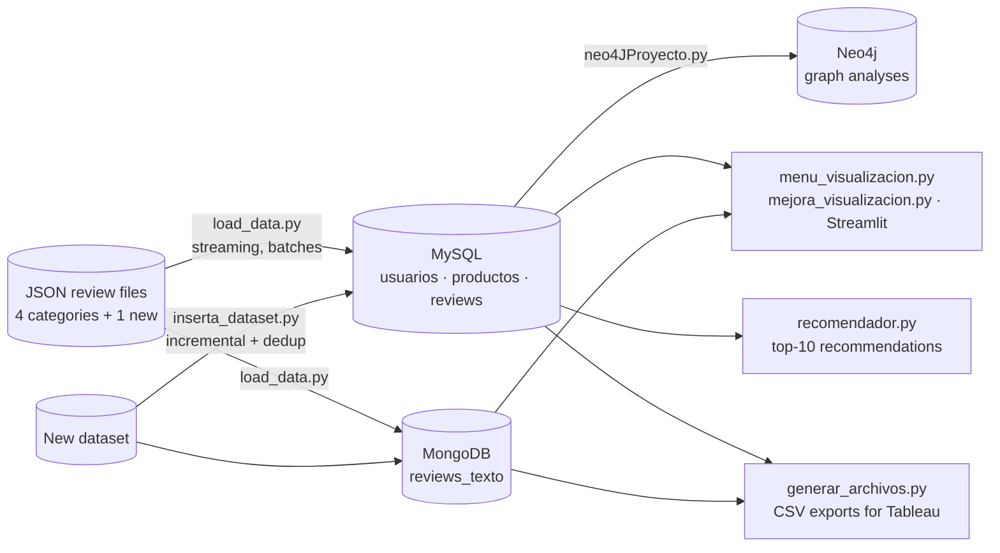
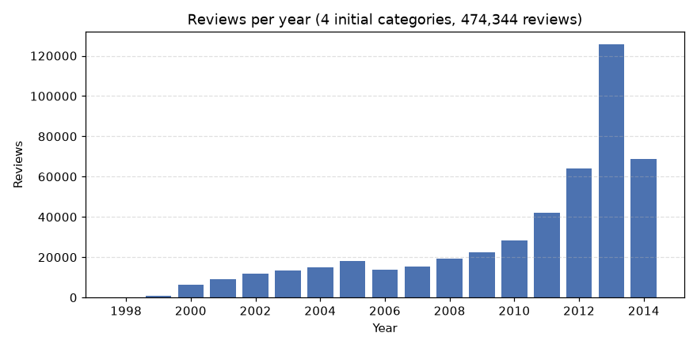
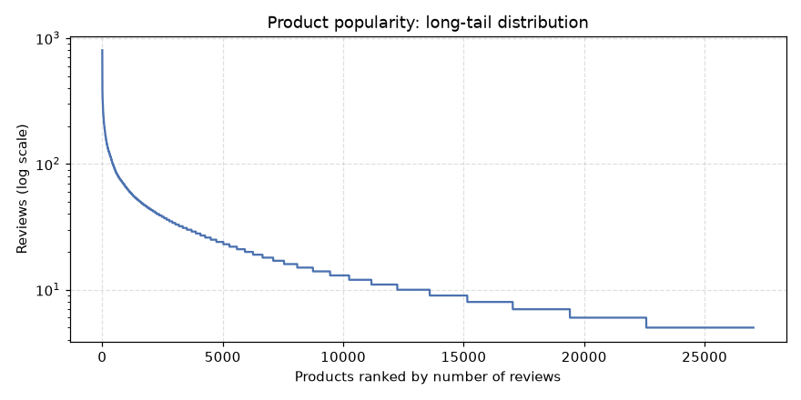
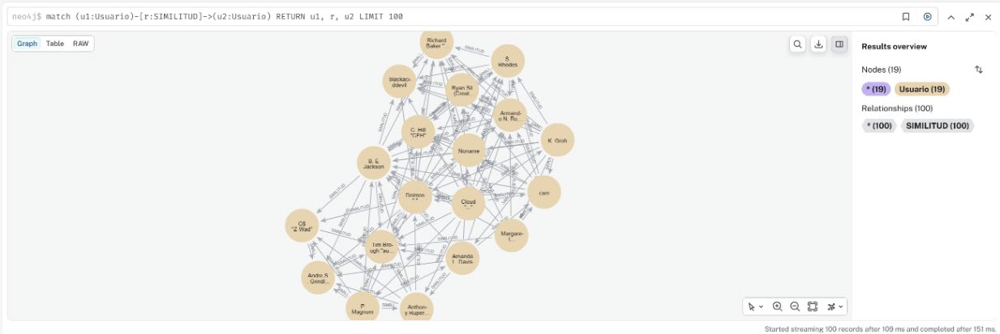
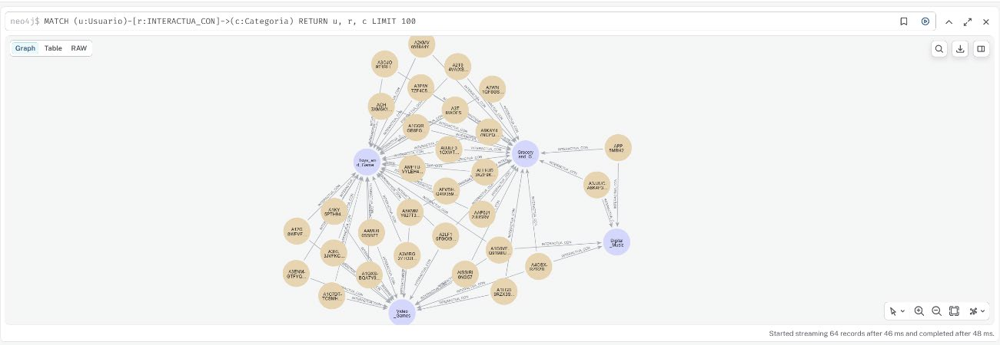

**English** | [Español](README.es.md)

# Amazon Reviews: Polyglot Persistence with MySQL, MongoDB and Neo4j

A data platform for **474,344 Amazon product reviews** that combines three database models, each used for what it does best:

- **MySQL** for the structured, relational part (users, products, ratings, dates)
- **MongoDB** for the free text (review body and summary)
- **Neo4j** for graph analysis (user similarity, user–product and user–category networks)

On top of the databases there is a streaming data loader, a visualisation menu, an interactive **Streamlit** dashboard, an incremental loader for new datasets with duplicate detection, and a popularity-based **recommender**.

> Pair project with **Lola Mancebo Olivares** for *Databases (Bases de Datos)*, 2nd year of the BSc in Mathematical Engineering and Artificial Intelligence, ICAI – Universidad Pontificia Comillas (2025/26).


---

## Architecture



## Data model

**Why split the data this way?** Ratings, votes and dates have a fixed structure and are queried with joins and aggregations, so they go to MySQL. Review text has variable length and is only read as a whole (e.g. for word clouds), which suits a document store. The graph layer is built *from* MySQL on demand, to analyse relationships that are awkward to express in SQL.

**MySQL (relational schema)**

```
usuarios (reviewer_id PK, reviewer_name)
productos (asin PK, categoria)
reviews  (review_id PK, reviewer_id FK → usuarios, asin FK → productos,
          overall, helpful_yes, helpful_total, unix_review_time, review_time DATE)
```

The same user can review products in several categories, so users and products are stored once and reviews reference them. `reviewTime` (`"07 9, 2012"`) is parsed into a proper `DATE`. Indexes on `reviewer_id`, `asin` and `review_time` support the most frequent queries.

**MongoDB (document)**

```
reviews_texto { _id, reviewerID, asin, categoria, unix_review_time, reviewText, summary }
```

**Neo4j (graph models built from MySQL)**

| Analysis | Nodes | Relationships |
|---|---|---|
| User similarity (top 30 most active users) | `Usuario` | `SIMILITUD {pearson, articulos_comunes}` |
| Users ↔ random products of a category | `Usuario`, `Articulo` | `PUNTUO {overall, unix_review_time}` |
| Multi-category users (first 400 by name) | `Usuario`, `Categoria` | `INTERACTUA_CON {num_articulos}` |
| 5 most popular products with < 40 reviews | `Usuario`, `Articulo` | `PUNTUO`, `TIENE_EN_COMUN {articulos_comunes}` |

User similarity is the Pearson correlation over co-rated products, implemented from scratch in Python.

## Results

<p align="center">
  
  
</p>

- **Growth:** review activity grows steadily from 1998 and peaks in 2013 (125,705 reviews). The drop in 2014 is because the dataset ends partway through that year.
- **Long tail:** 27,025 products. The most reviewed one has 802 reviews and the median only 10; the top 10 % of products concentrate **41 %** of all reviews.
- **Incremental loading:** the *Grocery and Gourmet Food* dataset (151,254 reviews) is added to the existing database without rebuilding it. Re-running the script inserts nothing new: every review is detected as a duplicate.

<p align="center">
  
  
</p>

*Left:* similarity network between the most active users (`SIMILITUD` edges carry the Pearson coefficient). *Right:* users who reviewed products in several categories, linked to each category with the number of products they reviewed there.

<p align="center">
  
</p>

*Word cloud of review summaries in Toys and Games (words longer than 3 letters), from MongoDB.*

**Recommender.** Given a user and a category, `recomendador.py` returns the 10 most popular products in that category the user has not reviewed yet, with average rating as a tie-breaker. A user-based collaborative-filtering model (KNN over Pearson similarity) was also explored. It reached only a 3.33 % hit rate because the user–item matrix is very sparse, so it was left out of the final version.

## Repository structure

```
amazon-reviews-polyglot-db/
├── src/
│   ├── configuracion.py        # DB names, credentials (from .env) and dataset paths
│   ├── db.py                   # Shared connections and JSON parsing
│   ├── load_data.py            # Part 1: create databases and load the 4 datasets
│   ├── menu_visualizacion.py   # Part 2: terminal menu with 7 charts
│   ├── neo4JProyecto.py        # Part 3: Neo4j menu with 4 graph analyses
│   ├── inserta_dataset.py      # Part 4: incremental load of a new dataset
│   ├── recomendador.py         # Part 5: top-10 popular products not yet reviewed
│   ├── generar_archivos.py     # Part 5: CSV exports for Tableau
│   └── mejora_visualizacion.py # Optional: Streamlit dashboard
├── exports/                    # CSVs exported from the full dataset
├── docs/figures/               # Figures used in this README
├── report/                     # Full report and poster (Spanish)
├── data/                       # Put the downloaded JSON files here (git-ignored)
├── docker-compose.yml          # MySQL + MongoDB + Neo4j
├── .env.example                # Template for credentials
└── requirements.txt
```

Code, comments and the report are in Spanish, as required by the course.

## How to reproduce the results

**Requirements:** Python 3.12 and Docker (or local installations of MySQL 8, MongoDB 7 and Neo4j 5).

1. **Clone the repository and install the dependencies**
   ```bash
   git clone https://github.com/jimenazubii/amazon-reviews-polyglot-db.git
   cd amazon-reviews-polyglot-db
   python3.12 -m venv .venv
   source .venv/bin/activate          # Windows: .venv\Scripts\activate
   pip install -r requirements.txt
   ```

2. **Configure credentials.** Copy the template and set your own passwords:
   ```bash
   cp .env.example .env
   ```
   The Neo4j password must be at least 8 characters long. `.env` is git-ignored, so credentials never reach the repository.

3. **Start the databases**
   ```bash
   docker compose up -d
   ```
   This starts MySQL (port 3306), MongoDB (27017) and Neo4j (Browser at http://localhost:7474, Bolt at 7687) with the credentials from `.env`.

4. **Download the data.** Get the *5-core* review files for Toys and Games, Video Games, Digital Music, Musical Instruments and Grocery and Gourmet Food from the [Amazon product data (2014) page](https://jmcauley.ucsd.edu/data/amazon/links.html). Unzip them into `data/` and rename them as follows:
   ```
   data/Toys_and_Games_5.json
   data/Video_Games_5.json
   data/Digital_Music_5.json
   data/Musical_Instruments_5.json
   data/Grocery_and_Gourmet_Food_5.json
   ```
   The files are about 660 MB in total and are not included in the repository. You can point to another folder with `DATA_DIR` in `.env`.

5. **Load the data** (creates the MySQL database, tables and MongoDB collection from scratch):
   ```bash
   python src/load_data.py
   ```
   Expected output: `Toys_and_Games: 167597`, `Video_Games: 231780`, `Digital_Music: 64706` and `Musical_Instruments: 10261` reviews processed.

6. **Explore the data**
   ```bash
   python src/menu_visualizacion.py           # terminal menu with 7 charts
   streamlit run src/mejora_visualizacion.py  # interactive dashboard
   python src/neo4JProyecto.py                # graph analyses; then open http://localhost:7474
   ```

7. **Incremental load, recommendations and exports**
   ```bash
   python src/inserta_dataset.py   # adds Grocery and Gourmet Food (151,254 reviews)
   python src/inserta_dataset.py   # run again: 0 new, 151,254 duplicates detected
   python src/recomendador.py      # e.g. user A2HD75EMZR8QLN, category Video_Games
   python src/generar_archivos.py  # regenerates the CSVs in exports/
   ```

## Changes since the course submission

This portfolio version keeps the original design and logic, with these improvements:

- **Credentials out of the code:** they are read from a git-ignored `.env` file, and the dataset path is configurable.
- **Fixed Streamlit app:** the original file contained unresolved Git merge-conflict markers and did not start. Two charts (ratings histogram and cumulative evolution) also ignored the selected category; now they filter by it. Queries are cached with `st.cache_data`, and the time axis shows dates instead of Unix timestamps.
- **Shared module (`db.py`):** the connection and parsing code that was duplicated in six scripts now lives in one place.
- **Consistent MongoDB documents:** both loaders store `unix_review_time`. The incremental loader also catches duplicates within the same file.
- **Reproducible environment:** `docker-compose.yml`, pinned `requirements.txt` and an `.env.example` template.

The refactored pipeline was re-tested end to end on MariaDB 10.11 (MySQL-compatible) with an in-memory MongoDB (mongomock) and a simulated Neo4j driver, using a sample of the real data. The original project ran on local MySQL, MongoDB and Neo4j servers.

## Dataset

Amazon review data (2014), 5-core subsets: every user and product has at least 5 reviews.

> R. He, J. McAuley. *Ups and downs: Modeling the visual evolution of fashion trends with one-class collaborative filtering.* WWW, 2016.
> J. McAuley, C. Targett, J. Shi, A. van den Hengel. *Image-based recommendations on styles and substitutes.* SIGIR, 2015.

## Authors

**Lola Mancebo Olivares** and **Jimena Zubizarreta Gómez**, BSc in Mathematical Engineering and Artificial Intelligence, ICAI – Universidad Pontificia Comillas, Madrid. We worked on all parts of the project together.
